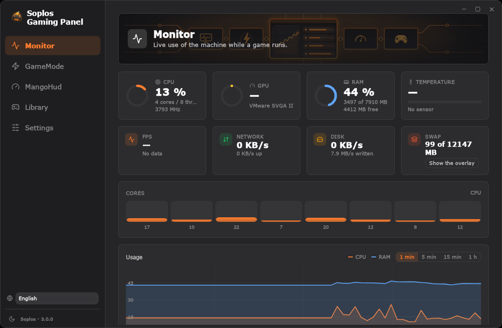
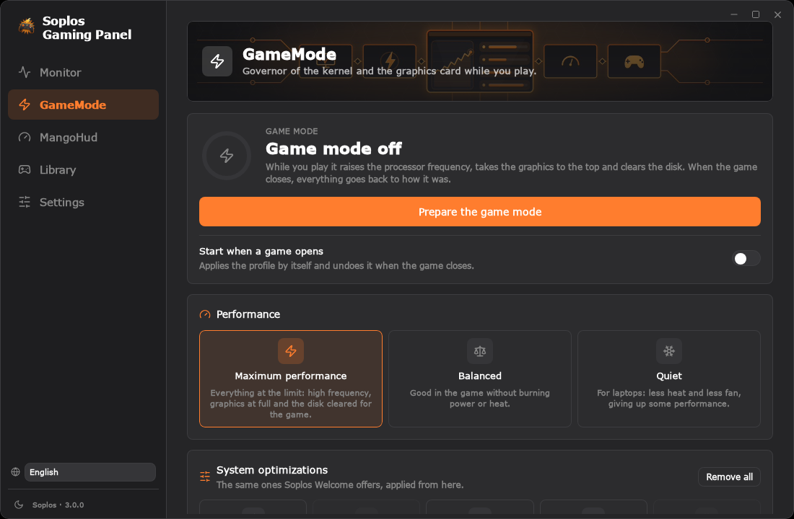
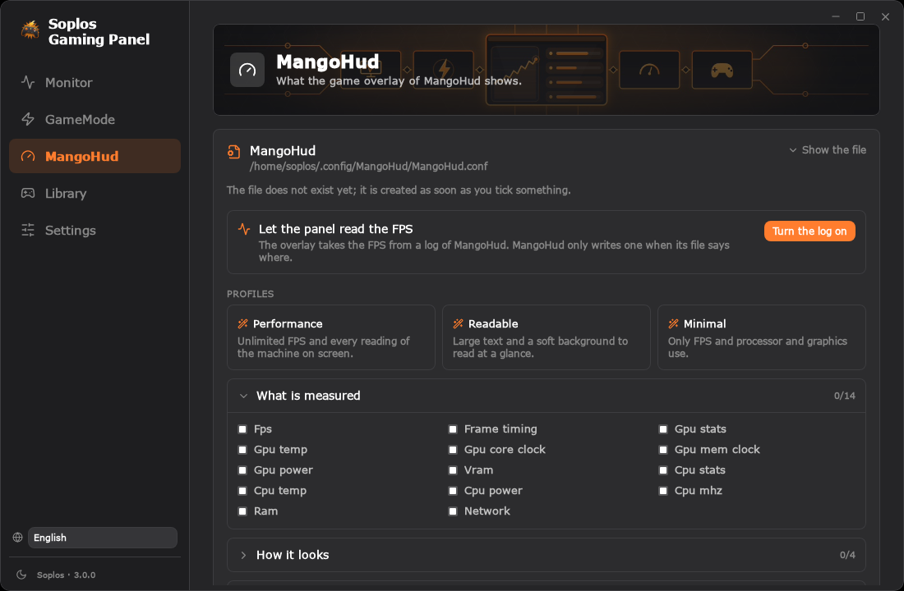
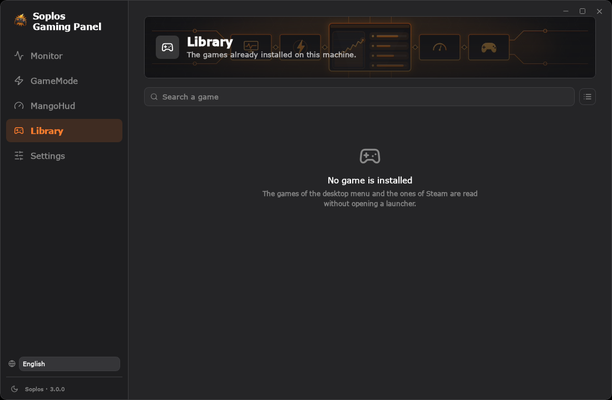
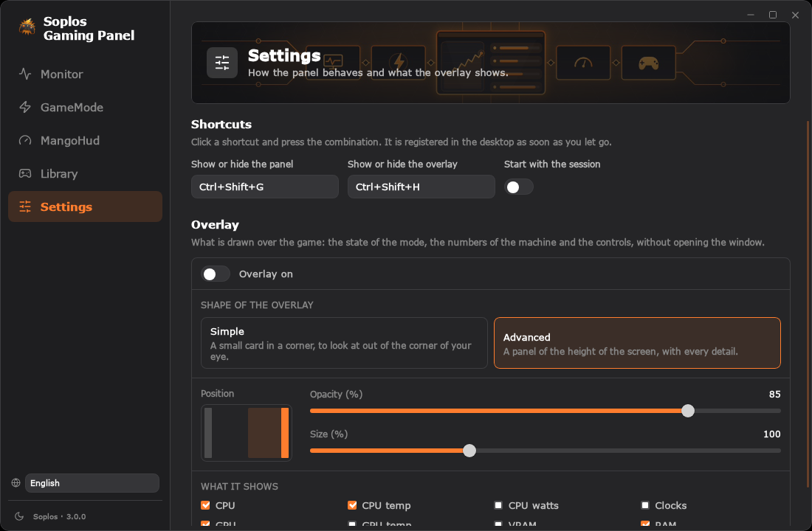

# Soplos Gaming Panel

Live gaming companion overlay for Soplos Linux (Boro, Tyson, Tyron).

Persistent quick-access panel, activated from the system tray or a global
hotkey (default `Ctrl+Shift+G`), providing:

- Live GameMode control via D-Bus (`com.feralinteractive.GameMode`)
- MangoHud configuration (FPS/resource in-game overlay)
- CPU / GPU / RAM / temperature monitor
- Library of the games already installed, from the desktop menu and from Steam

This is the 3.0 version, in the same stack as the rest of the Soplos 3.0
programs: Tauri 2, Svelte 4, TypeScript and Tailwind. It replaces the Python
prototype of 2026-07-10, which stays as the reference of its decisions.

|  The monitor, with the use of the processor, the graphics card and the memory, the sensors and the chart of the last minute |  GameMode, with the state of the mode, the profile and the system optimizations |
|:---:|:---:|
|  MangoHud, with the keys of its file as boxes, grouped in sections that open and close |  The library, with the games that the desktop menu and Steam already have |
|  Settings, with the shortcuts, the overlay and the start with the session | |

## Relationship with Soplos Welcome

Soplos Welcome's Gaming Center tab already handles one-time installation and
configuration of GameMode, MangoHud, sysctl tweaks, RyzenAdj, etc. Soplos
Gaming Panel does not duplicate that — it assumes those tools may already be
installed and focuses on live control and monitoring while gaming. If a
dependency (GameMode, MangoHud) is missing, the panel offers a fallback
installer using the same criteria as Soplos Welcome.

## Relationship with soplos-game-daemon

`soplos-game-daemon` (planned) builds gaming-optimized kernels via
soplos-kernel-installer and automatically detects/registers running games
with GameMode over D-Bus. Soplos Gaming Panel is the visual surface — it
only queries GameMode state or triggers it manually, it does not build
kernels or reimplement process detection.

## How the overlay is drawn

The window is a Tauri one, but the overlay is a native GTK3 window in the
same process: Tauri already runs on GTK3, so no extra program is needed. The
backend is chosen at run time:

| Desktop / protocol | Overlay |
|---|---|
| wlroots, KDE Plasma Wayland, sway, Hyprland | `gtk-layer-shell` |
| X11 (Xfce and others) | override-redirect window, above |
| GNOME Wayland | always-on-top window (no layer-shell in mutter) |

Global shortcuts follow the same rule: on X11 the program hears the keys
itself; on Wayland the combination is registered in the desktop (GNOME
custom keybinding, Xfce keyboard shortcut, KDE must be set in its own
settings).

## How the library finds the games

There is no guessing by process name. A game is what the desktop says it is:
an entry whose `Categories` include `Game`, in the folders of the system, of
Flatpak and of the user. Steam keeps its games apart, in `steamapps` of each
library, so its manifests are read as well, and its covers are taken from the
cache of the client. Lutris and Heroic end up as entries of the menu, so they
come with the rest. A cover the user chooses is copied to
`~/.local/share/soplos-gaming-panel/covers`.

## Requirements

- Node.js 20 or later and Cargo 1.80 or later, to build it
- GTK 3 and WebKitGTK 4.1 (already needed by Tauri)
- gtk-layer-shell: `libgtk-layer-shell-dev` to build it, `libgtk-layer-shell0`
  to run it (the package depends on it). On Wayland it makes the overlay a
  widget of the desktop, as the panels of Plasma and Xfce are
- GameMode and MangoHud, optionally, for the pages that control them

## Development

```
npm install
npm run tauri dev
```

`src-tauri/resources/` holds what goes into the .deb: desktop entry, polkit
policy, AppStream metadata and the manual page. It also holds the extension of
GNOME Shell that places the overlay on GNOME, which does not speak layer-shell
(`gnome-shell/soplos-gaming-overlay@soplos.org`). `./package.sh` builds the
package and copies it to the shared folders.

See `tareas.txt` for the full architecture plan and the phases of the work.
